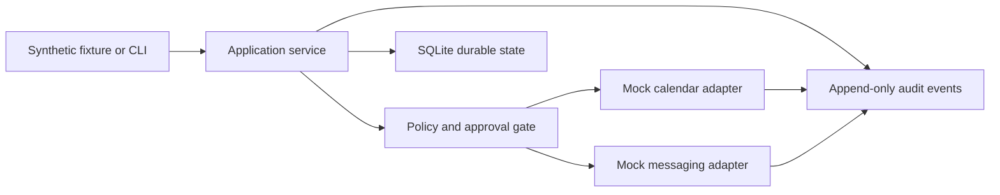

# Family Steward

Family Steward is a small, offline reference application for turning household requests into durable items, approval-ready actions, and an observable event history. It demonstrates how an applied AI system can keep deterministic policy and state outside the language layer.

This public project was built from scratch with fictional household data. It is not connected to a real household, messaging account, calendar, contact list, or production runtime.

## What it implements

- Durable SQLite state for groceries, tasks, and notes.
- Mock calendar and messaging actions that always require explicit approval.
- Approval, denial, failure, and retry state transitions.
- Idempotency for repeated external-style action requests.
- Append-only audit events with correlation IDs.
- A local CLI and deterministic synthetic scenario.
- Standard-library tests with no network or private infrastructure.

## Why approval boundaries matter

Creating a local grocery item is reversible and stays inside the application. Sending a message or creating a calendar event has an external effect, so Family Steward prepares those actions in `pending_approval` state. A fictional user must explicitly approve before a mock adapter can run.

The adapters in this repository never contact a real service. They return deterministic success or simulated timeout results so failure handling can be tested safely.

## Architecture



The service owns validation, idempotency, state transitions, and authorization checks. Mock adapters are isolated behind the approval gate. SQLite preserves state and event history across restarts.

## Local setup

Requires Python 3.11 or newer.

```bash
python3 -m venv .venv
source .venv/bin/activate
python -m pip install -e .
```

Initialize a local database and run the synthetic scenario:

```bash
family-steward --db ./var/demo.db init
family-steward --db ./var/demo.db scenario fixtures/calendar-approval.json
family-steward --db ./var/demo.db history
```

The scenario uses the fictional River Household with fictional members Casey and Jordan. It creates one grocery item, approves a mock calendar action, records a simulated messaging timeout, and retries that mock action successfully.

## CLI examples

Create local durable items:

```bash
family-steward add grocery "Oat milk"
family-steward add task "Pack the library books"
family-steward add note "Use the blue reusable bag"
family-steward list
```

Prepare and approve a mock calendar action:

```bash
family-steward prepare-calendar "School pickup" "Thursday at 3:15 PM"
family-steward approve 1 --actor Casey
```

Preparation does not execute the action. Approval invokes only the local mock adapter.

## Tests

```bash
python -m unittest discover -s tests -v
```

The tests cover durable item state, approval enforcement, denial, idempotency, simulated failure and retry, audit events, and restart persistence.

## Implemented versus planned

Implemented now:

- Offline CLI workflows.
- SQLite persistence.
- Deterministic approval and failure state machines.
- Mock calendar and messaging adapters.
- Synthetic fixtures and automated tests.

Not implemented:

- Language-model interpretation.
- Real calendar or messaging integrations.
- Web or mobile interfaces.
- Authentication, multi-household tenancy, or production deployment.
- Production privacy, availability, or security guarantees.

## Privacy and safety boundaries

- All names, messages, and household data in this repository are fictional.
- No real provider credentials or runtime configuration are required.
- No adapter performs network activity or a real-world action.
- Local databases, logs, environment files, caches, and generated artifacts are ignored.
- Examples should remain synthetic when this project is extended.

## Repository status

This is an intentionally compact reference implementation for architecture review, local experimentation, and portfolio discussion. It is not a production household assistant.

## License

No open-source license has been selected. Copyright and reuse rights are reserved unless a license is added later.
